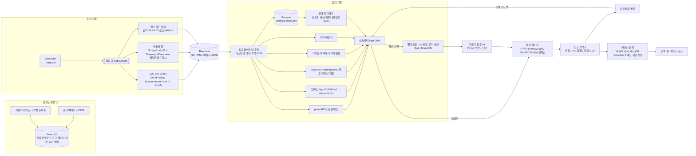

# AI 기반 온라인 위조상품 탐지·단속 기술 스택 리서치

> 작성 기준일: 2026-11-10 · 관점: MarqVision / 위고페어(WEGOFAIR) / 페이커즈(FAIKERZ)급 시스템을 직접 구축하려는 팀
> 표기: **[확인]** 원문/공식 문서로 확인, **[2차]** 2차 자료·벤더 주장, **[추정]** 작성자 판단(검증 필요)

---

## 0. 요약 (TL;DR)

- 상용 브랜드 보호 SaaS의 핵심은 "최첨단 단일 모델"이 아니라 **수집(커버리지) → 후보 검색(임베딩·로고·키워드) → 판정(규칙+ML+멀티모달 LLM+전문가 검수) → 증거화 → 플랫폼별 신고 자동화 → 판매자 네트워크 누적 DB**로 이어지는 파이프라인 운영 역량이다.
  - MarqVision: 이미지 인식 + 제목/설명/가격 의미 분석, 판매자 군집(Seller Intel Lab), 생성형 AI로 신고서 작성 자동화를 내세움 [2차] ([MarqVision](https://www.marqvision.com/anti-counterfeit-solution), [MarqVision 뉴스](https://www.marqvision.com/news/marqvision-advances-ai-analytics-to-detect-counterfeit-and-unauthorized-sales), [ITPro](https://www.itpro.com/business-strategy/intellectual-property/357164/marqvision-detects-counterfeit-products-with-deep), [Visionary Marketing 2022](https://visionarymarketing.com/en/2022/11/counterfeiting-on-marketplaces/?nonamp=1/)).
  - 위고페어: 1,500+ 플랫폼 24시간 모니터링, 시험구매(Test Purchase) 증거화, 사업자/플랫폼을 바꾸는 판매자 DB 확대, **"전문가 검수형 AI"(변리사·IP 전문가가 신고 전 검토)**, 특허법인 컨소시엄 [2차] ([전자신문 2026-04-14](https://www.etnews.com/20260414000036), [아시아경제 2026-11-03](https://view.asiae.co.kr/en/article/2026110216493918196), [벤처스퀘어](https://www.venturesquare.net/1097935/), [전자신문 원클릭 신고 2024](https://m.etnews.com/20241113000030)).
  - 페이커즈: AI·빅데이터 + IP 전문가 협업, 500+ 마켓/SNS [2차] ([바이라인 2022](https://byline.network/2022/05/16-201/)). 기술 세부 공개 자료는 거의 없음.
- 2024~2026 기술 판도: **(1) 범용 비전 임베딩(SigLIP 2/DINOv2·v3) + 벡터DB로 후보 검색**, **(2) Open-vocabulary 검출기(OWLv2/Grounding DINO)로 로고·디자인 요소 국소화**, **(3) 멀티모달 LLM(GPT/Claude/Gemini/Qwen-VL)으로 근거 서술형 판정과 신고서 초안**, **(4) 판매자 그래프 군집**이 사실상 표준 조합. 학계에서 "이커머스 위조 판정"을 정면으로 다룬 공개 논문은 의외로 적고, 대부분 플랫폼 내부 비공개(Amazon·Alibaba는 보고서/특허만 공개).
- 신규 리스크: 생성형 AI가 제품 사진·광고 문구·쇼핑몰 전체를 복제 → 사칭 사이트/피싱 대응 수요 증가 [2차] ([아시아경제 2026-11](https://view.asiae.co.kr/en/article/2026110216493918196)).
- 시장: 지식재산처 집계 해외 플랫폼 K-브랜드 위조품 차단 210,034건(2년간 +30%), 피해기업 77.8% 중소기업 [2차, 동 기사].

---

## 1. 데이터 수집 (Acquisition)

### 1.1 크롤링 스택

| 계층              | 선택지                                                                                                      | 비고                                                                                                                                                                                                                                                                         |
| ----------------- | ----------------------------------------------------------------------------------------------------------- | ---------------------------------------------------------------------------------------------------------------------------------------------------------------------------------------------------------------------------------------------------------------------------- |
| 정적/HTTP         | Scrapy, `curl_cffi`(TLS/JA3 위장), httpx                                                                    | 대량·저비용. 목록/검색결과 페이지                                                                                                                                                                                                                                            |
| 헤드리스          | Playwright, **Patchright**(Playwright 포크, CDP 누수 패치), **Camoufox**(Firefox 기반 anti-detect, MPL-2.0) | JS 렌더링, 무한스크롤, SNS. Camoufox는 2025말~2026초 유지보수 공백 후 재개, 버전 고정 권장 [2차] ([ScrapingBee](https://www.scrapingbee.com/blog/how-to-scrape-with-camoufox-to-bypass-antibot-technology/), [skills.sh](https://skills.sh/krishamaze/skills/camoufox-2026)) |
| 크롤러 프레임워크 | **Crawlee**(세션풀·프록시 회전·재시도 내장, Camoufox 템플릿 존재), scrapy-playwright                        | [Apify 템플릿](https://securitybyobscurity.apify.com/templates/ts-crawlee-playwright-camoufox), [Zyte: scrapy-playwright](https://www.zyte.com/blog/the-missing-middle-ground-in-scrapy-playwright-just-got-filled/)                                                         |
| 프록시            | 레지덴셜/모바일 프록시(Bright Data, Oxylabs, Smartproxy 등), 국가별 출구                                    | 국가별 가격·노출 차이 때문에 현지 IP 필수                                                                                                                                                                                                                                    |
| 매니지드          | Zyte API, Bright Data Web Unlocker/Datasets, Apify Actors                                                   | 커버리지 확보 초기엔 구매가 저렴할 수 있음 [추정]                                                                                                                                                                                                                            |
| 스케줄/큐         | Temporal / Airflow / Celery + Redis/Kafka                                                                   | 키워드×플랫폼×국가 작업 단위                                                                                                                                                                                                                                                 |

- 2026 벤치마크 블로그는 "스텔스만으로는 Cloudflare 대상이 48시간 내 차단"된 사례를 보고 → **속도 제한·백오프·세션 재사용·API 우선** 전략이 현실적 [2차] ([anti-detect benchmark 2026](https://ianlpaterson.com/blog/anti-detect-browser-benchmark-patchright-nodriver-curl-cffi/), [Scrapfly](https://scrapfly.io/blog/posts/best-stealth-browsers)).
- 실무 팁 [추정]: (a) 검색결과 페이지만 고빈도, 상세페이지는 후보로 선별 후 수집, (b) 이미지 CDN은 원본 URL·해시만 저장하고 후보만 다운로드, (c) SNS 폐쇄형 채널(카카오 오픈채팅, 텔레그램, 위챗)은 자동 수집보다 키워드 모니터링+수동 잠입, 시험구매로 대응(페이커즈도 SNS 폐쇄형 채널 탐지 난점 언급 [2차]).

### 1.2 공식 API (가능하면 API 우선)

| 플랫폼                         | API                                                                                                                                                                                     | 용도/제약                                                                                                                                                                                                                                                                                                                                                                                                                                                                                                                                                                                     |
| ------------------------------ | --------------------------------------------------------------------------------------------------------------------------------------------------------------------------------------- | --------------------------------------------------------------------------------------------------------------------------------------------------------------------------------------------------------------------------------------------------------------------------------------------------------------------------------------------------------------------------------------------------------------------------------------------------------------------------------------------------------------------------------------------------------------------------------------------- |
| Amazon                         | **SP-API** Catalog Items `searchCatalogItems`(식별자/키워드 검색, 앱당 약 2 rps 수준), Product Pricing `getItemOffers`(2022 변경 후 0.5 rps), Listings Restrictions(브랜드 게이팅 확인) | 셀러/벤더 계정 필요, 타 판매자 오퍼 조회는 제한적 → 브랜드 보호용 전체 스캔에는 부족 [확인] ([Catalog Items 레퍼런스](https://developer-docs.amazon.com/sp-api/docs/catalog-items-api-v2022-04-01-reference), [rate limits](https://developer-docs.amazon.com/sp-api/lang-es_ES/docs/catalog-items-api-rate-limits), [throttling 변경](https://developer-docs.amazon.com/sp-api/changelog/sp-api-throttling-adjustments), [Listings restrictions](https://developer-docs.amazon.com/sp-api/docs/get-listings-restrictions)). 브랜드는 Brand Registry/Project Zero(자가 삭제 권한)가 핵심 채널 |
| eBay                           | **Browse API** `item_summary/search`, **`search_by_image`**(이미지로 검색)                                                                                                              | 일일 호출 한도 존재, 정확한 수치는 Developer Analytics API로 키셋별 확인. Buy API는 별도 라이선스 필요 [확인] ([Browse overview](https://developer.ebay.com/api-docs/buy/browse/overview.html), [searchByImage](https://www.developer.ebay.com/api-docs/buy/browse/resources/item_summary/methods/searchByImage), [API call limits](https://developer.ebay.com/develop/api/buy/api_call_limits)). 브랜드 신고는 VeRO 프로그램                                                                                                                                                                 |
| 네이버                         | 검색 API(쇼핑 `shop.json`), 쇼핑인사이트                                                                                                                                                | 검색 API가 **NAVER API HUB(네이버클라우드)로 이전, 종량제(한시 무료)**. 기존 "일 25,000건" 한도는 현행 확인 안 됨 → HUB 문서 확인 필요 [확인/일부] ([API HUB 개요](https://api.ncloud-docs.com/docs/naver-api-hub-overview), [브런치: 약관 변화](https://brunch.co.kr/@ainote/123))                                                                                                                                                                                                                                                                                                           |
| 쿠팡                           | 쿠팡 파트너스 API(제휴 링크·상품검색 일부), Wing Open API(판매자 자기 상품)                                                                                                             | 타 판매자 전수 모니터링 API는 사실상 없음 [추정]. 신고는 지식재산권 침해신고 채널 ([MarqVision 쿠팡 가이드](https://www.marqvision.com/blog/how-to-report-a-fake-on-coupang))                                                                                                                                                                                                                                                                                                                                                                                                                 |
| Shopee / Lazada                | Open Platform(판매자·ISV용 주문/상품 API)                                                                                                                                               | 타 판매자 검색용이 아님. 단속은 **Shopee Brand IP Portal**(국가별 권리 등록, 대량 업로드), Lazada IPP [2차] ([Red Points Shopee](https://www.redpoints.com/blog/shopee-report-infringement), [MarqVision Shopee 가이드](https://www.marqvision.com/blog/shopee-ip-enforcement-guide), [Red Points Lazada](https://www.redpoints.com/blog/lazada-report-scammer/))                                                                                                                                                                                                                             |
| Alibaba/AliExpress/1688/Taobao | Alibaba **IPP(IP Protection Platform)**                                                                                                                                                 | 신고 포털. Corsearch 등은 IPP 계정 연동 자동신고 제공 [2차] ([Corsearch Zeal 문서](https://help.zeal.corsearch.com/en/articles/126-ip-portal-auto-enforcement-configuration))                                                                                                                                                                                                                                                                                                                                                                                                                 |
| TikTok                         | Research API, Commercial Content API                                                                                                                                                    | **연구자 전용·상업적 이용 금지**, 크리에이터/광고주/상업 사용자 불가 → 상용 단속 시스템에 사용 불가 [2차/공식 FAQ] ([TikTok Research API FAQ](https://developers.tiktok.com/doc/research-api-faq), [TechCrunch 2023](https://techcrunch.com/2023/07/20/tiktok-ads-transparency))                                                                                                                                                                                                                                                                                                              |
| Instagram                      | Graph API Hashtag Search                                                                                                                                                                | 비즈니스/크리에이터 계정당 **롤링 7일 30개 고유 해시태그**, 앱 리뷰(Public Content Access) 필요, 스토리 미지원 [확인] ([Meta 문서](https://developers.facebook.com/docs/instagram-platform/instagram-api-with-facebook-login/hashtag-search), [recently_searched_hashtags](https://developers.facebook.com/docs/instagram-platform/instagram-graph-api/reference/ig-user/recently_searched_hashtags)). 계정 여러 개 운영 필요 → 약관 위험                                                                                                                                                     |
| Google                         | Custom Search JSON API / SerpAPI류, Google Lens 결과(비공식)                                                                                                                            | 사칭몰·독립 도메인 발견용. 도메인은 WHOIS/RDAP, Certificate Transparency(crt.sh) 모니터링 병행 [추정]                                                                                                                                                                                                                                                                                                                                                                                                                                                                                         |

### 1.3 스크래핑 법적 한계

**미국**

- _hiQ v. LinkedIn_: 9th Cir.(2022)는 공개 데이터 스크래핑이 CFAA "무권한 접근"에 해당하지 않을 가능성이 높다고 봄. 그러나 2022.11 지방법원은 **이용약관의 스크래핑 금지 조항이 계약상 유효**하다고 판단, 2022.12 hiQ가 $500,000 동의판결·영구금지·데이터 삭제로 종결 → 분쟁 축이 **계약(ToS) 위반**으로 이동 [확인] ([ZwillGen](https://www.zwillgen.com/alternative-data/hiq-v-linkedin-wrapped-up-web-scraping-lessons-learned/), [Polsinelli](https://www.polsinelli.com/publications/data-scraping-update-linkedin-v-hiq-answers-some-questions-but-leaves-many-more-open)).
- _Meta v. Bright Data_ (N.D. Cal., 2024.1.23, 3:23-cv-00077-EMC): **로그아웃 상태의 공개 데이터 스크래핑은 Meta 약관 위반 아님**. 단 로그인 필요 데이터는 판단 안 함 [확인] ([FBM](https://www.fbm.com/technology/publications/major-decision-affects-law-of-scraping-and-online-data-collection-meta-platforms-v-bright-data/), [TechCrunch](https://techcrunch.com/2024/01/24/court-rules-in-favor-of-a-web-scraper-bright-data-which-meta-had-used-and-then-sued), [Quinn Emanuel](https://www.quinnemanuel.com/the-firm/news-events/client-alert-what-does-the-meta-v-bright-data-summary-judgment-ruling-mean-for-web-scraping/)).
- 설계 원칙: **로그인 뒤 데이터 수집 금지, 계정 생성 자동화 금지(hiQ의 가짜 프로필이 책임 근거), 공개 페이지·저빈도·API 우선**.

**한국**

- _잡코리아 v. 사람인_ (서울고법 2017.4.6. 2016나2019365): 크롤링으로 채용정보 DB를 반복·체계적으로 복제 → **데이터베이스제작자 권리 침해**, 약 15.4억 원 배상 [확인] ([nepla 판결](https://www.nepla.ai/case/서울고등법원/2016나2019365), [바이라인](https://byline.network/2016/02/1-64/)).
- _야놀자 v. 여기어때_: 형사(정보통신망 침입·DB권 침해·업무방해)는 대법원 2022년 무죄 확정(크롤링 금지 조치 부재 등이 고려), **민사는 서울고법이 10억 원 배상 인정** [2차] ([비즈한국](https://bizhankook.com/articles/27377.html), [다음/한경 긱스](https://v.daum.net/v/Fi3RbZBWW5)).
- **부정경쟁방지법 제2조 제1호 카목(데이터 부정사용, 2022.4.20 시행)**: 업으로 제공·상당량 축적·비밀 아닌 데이터를 접근권한 없이 취득/사용하는 행위 등 규율. 단순 크롤링 전부가 위반은 아니나 **접근제한 우회(차단 우회, 계정 우회)** 시 리스크 [2차] ([디지털데일리](https://www.ddaily.co.kr/page/view/2023112400133973443), [nepla 위키](https://www.nepla.ai/wiki/%EC%A7%80%EC%8B%9D%EC%9E%AC%EC%82%B0/%EB%B6%80%EC%A0%95%EA%B2%BD%EC%9F%81/%EB%8D%B0%EC%9D%B4%ED%84%B0-%EB%B6%80%EC%A0%95%EC%82%AC%EC%9A%A9-rv5n72p1g8zm), [로톡](https://www.lawtalk.co.kr/posts/39550)).
- 브랜드 보호 목적 수집의 정당화 논리 [추정]: 경쟁 서비스용 DB 복제가 아니라 권리 침해 증거 확보 목적, 필요 최소 범위(침해 의심 리스팅만 상세 수집), 개인정보(판매자 실명·연락처)는 개인정보보호법상 정당한 이익/법령상 의무 근거 검토, 보관기간 한정. **법률 자문 필수.**

---

## 2. 탐지 신호와 모델

### 2.1 전체 판정 로직 (권장 다단계)

1. **후보 생성(Recall)**: 키워드(브랜드명·오탈자·우회어 "st", "미러", "정품급", "1:1", "레플"), 이미지 임베딩 근접 검색, 로고 검출, 공식 이미지 도용 해시 매칭.
2. **특징 추출**: 가격 비율(정가 대비), 판매자 위치/신규성/판매량, 텍스트 우회 표현, 이미지 도용 여부, 로고 왜곡, 다른 침해 판매자와의 연결.
3. **판정(Precision)**: GBDT(LightGBM) 등 표 형식 스코어 + 멀티모달 LLM 근거 서술 + 브랜드별 규칙 → **고신뢰 자동신고 / 중간 전문가 검수 / 저신뢰 보류**.
4. **피드백 루프**: 플랫폼 처리 결과(삭제/반려/이의제기)를 라벨로 재학습. Amazon도 삭제 결과를 자동보호 알고리즘에 재투입한다고 밝힘 [2차] ([Retail TouchPoints](https://www.retailtouchpoints.com/features/industry-insights/how-amazons-anti-counterfeit-unit-keeps-fake-products-off-its-site)).

> 주의: 온라인 리스팅만으로 "진품/가품"을 물리 판정하는 것은 불가능에 가깝다. 실제 신고 근거는 대개 **상표 무단사용, 정품 이미지 도용(저작권), 비정상 가격, 우회표현, 판매자 이력**이며 최종적으로 시험구매로 확인한다.

### 2.2 이미지 유사도 / 근중복 검색

| 구성                                          | 레퍼런스                                                                                                                                                                                                                         |
| --------------------------------------------- | -------------------------------------------------------------------------------------------------------------------------------------------------------------------------------------------------------------------------------- |
| 비전-언어 임베딩                              | CLIP (arXiv:2103.00020, [openai/CLIP](https://github.com/openai/CLIP)), **OpenCLIP** ([mlfoundations/open_clip](https://github.com/mlfoundations/open_clip)), SigLIP (arXiv:2303.15343), **SigLIP 2** (arXiv:2502.14786, 다국어) |
| 자기지도 비전 임베딩(세부 형태 유사도에 강함) | **DINOv2** (arXiv:2304.07193, [facebookresearch/dinov2](https://github.com/facebookresearch/dinov2)), DINOv3 (arXiv:2508.10104)                                                                                                  |
| 퍼셉추얼 해시(도용 이미지·리사이즈/크롭 탐지) | [imagehash](https://github.com/JohannesBuchner/imagehash)(pHash/dHash), Meta **PDQ/TMK** ([facebook/ThreatExchange](https://github.com/facebook/ThreatExchange))                                                                 |
| 벡터 검색                                     | **FAISS** (arXiv:1702.08734; The Faiss library arXiv:2401.08281, [facebookresearch/faiss](https://github.com/facebookresearch/faiss)), **Milvus** ([milvus-io/milvus](https://github.com/milvus-io/milvus)), Qdrant, pgvector    |
| 대규모 비주얼 서치 사례                       | Visual Search at Alibaba (KDD 2018, arXiv:2102.04674)                                                                                                                                                                            |
| 제품 매칭 데이터셋                            | Products-10K (arXiv:2008.10545), Amazon Berkeley Objects (arXiv:2110.06199), Stanford Online Products (arXiv:1511.06452), WDC Products (arXiv:2301.09521), Kaggle "Shopee – Price Match Guarantee"                               |

실무 레시피 [추정]: 브랜드 정품 카탈로그(공식 이미지·SKU별 다각도) → SigLIP2/DINOv2 임베딩 인덱스, 의심 리스팅 이미지 → (a) pHash로 "공식 이미지 도용" 즉시 판별, (b) 임베딩 top-k로 "어떤 SKU를 모방했는지" 매핑, (c) 브랜드별 소량 라벨로 linear probe/LoRA 미세조정.

### 2.3 로고·디자인 요소 검출

| 구분                 | 레퍼런스                                                                                                                                                                                                                                                                                                                                                                                                                                                                                                         |
| -------------------- | ---------------------------------------------------------------------------------------------------------------------------------------------------------------------------------------------------------------------------------------------------------------------------------------------------------------------------------------------------------------------------------------------------------------------------------------------------------------------------------------------------------------- |
| Open-vocabulary 검출 | OWL-ViT (arXiv:2205.06230), **OWLv2** (arXiv:2306.09683, [google-research/scenic](https://github.com/google-research/scenic)), **Grounding DINO** (arXiv:2303.05499, [IDEA-Research/GroundingDINO](https://github.com/IDEA-Research/GroundingDINO)), YOLO-World (arXiv:2401.17270), Florence-2 (arXiv:2311.06242) — 텍스트 프롬프트 또는 **이미지 쿼리(one-shot)**로 신규 브랜드 로고 탐지                                                                                                                       |
| 폐쇄형 고속 검출     | YOLO 계열(Ultralytics) 브랜드별 파인튜닝                                                                                                                                                                                                                                                                                                                                                                                                                                                                         |
| 로고 데이터셋        | **LogoDet-3K** (arXiv:2008.05359, 3,000 클래스·158,652 이미지·~20만 객체, [Wangjing1551/LogoDet-3K-Dataset](https://github.com/Wangjing1551/LogoDet-3K-Dataset)), **QMUL-OpenLogo** (arXiv:1807.01964, BMVC 2018, 352 클래스·27,083 이미지, open-set 프로토콜, [qmul-openlogo.github.io](https://qmul-openlogo.github.io)), **FoodLogoDet-1500** (arXiv:2108.04644, ACM MM 2021, [hq03/FoodLogoDet-1500-Dataset](https://github.com/hq03/FoodLogoDet-1500-Dataset)), Logo-2K+ (arXiv:1911.07924), FlickrLogos-32 |
| 서베이               | Deep Learning for Logo Detection: A Survey (arXiv:2210.04399)                                                                                                                                                                                                                                                                                                                                                                                                                                                    |

권장 구조 [추정]: OWLv2/Grounding DINO로 "로고 후보 영역" 검출 → crop을 브랜드 로고 갤러리와 임베딩 비교(open-set 검색) → 위치·왜곡(좌우반전, 글자 변형) 특징을 판정기에 투입. 위조범이 로고를 블러/스티커 처리하는 경우가 많아 **패턴(모노그램), 하드웨어, 라벨 형태** 같은 디자인 요소도 쿼리로 등록.

### 2.4 OCR

- **PaddleOCR** (PP-OCRv5, 한/중/일 강함, [PaddlePaddle/PaddleOCR](https://github.com/PaddlePaddle/PaddleOCR)), EasyOCR, docTR, 클라우드(Google Vision, Naver CLOVA OCR). 상품 이미지 내 "정품급", 가격, 카톡 ID/위챗 ID, 워터마크(원 판매처) 추출 → 판매자 연결 단서.
- 최근에는 Qwen2.5-VL(arXiv:2502.13923) 등 VLM이 OCR+이해를 동시에 수행 → 비용 고려해 1차는 PaddleOCR, 2차 VLM [추정].

### 2.5 가격 이상치

- 브랜드·SKU·국가·채널별 기준가(정가, 공식몰, 승인 리셀러 분포) 대비 비율. 규칙(예: 정가 30% 미만) + 로버스트 z-score/IQR + Isolation Forest. 중고/병행수입/아울렛과 구분하기 위해 상태(new/used), 판매자 유형 피처 필수 [추정].
- 병행수입은 상표권 침해가 아님(국내 관세청 고시도 병행수입 범위 규정) → 오탐 주요 원인 [2차] ([nepla 병행수입](https://www.nepla.ai/wiki/지식재산/상표/병행수입-상표권-통관보류-대응방법-6349gp0729zx)).

### 2.6 판매자 네트워크 / 그래프

- 노드: 판매자 계정, 상점, 이미지 해시, 전화/메신저 ID, 반품주소, 도메인, 결제정보(가능 시), 텍스트 템플릿. 엣지: 공유 속성. → 연결요소/Louvain/Leiden 군집으로 **"한 조직의 N개 계정"** 식별 → 일괄 신고·Schedule A 피고 목록·재등록 감시.
- 학술 근거: 공유 이미지 기반 위조 판매자 연결 탐지(Taobao/Instagram/Carousell 47.3만 이미지, 객체인식 대비 30% 향상; ACM TOMM, [10.1145/3311785](https://dl.acm.org/doi/10.1145/3311785)), 후속 연구 Taobao 15.3만 이미지·네트워크 중심성 피처(ACM, [10.1145/3524135](https://dl.acm.org/doi/10.1145/3524135)).
- GNN 사기탐지: CARE-GNN(위장 사기범 대응, arXiv:2008.08692, YelpChi/Amazon 데이터), PC-GNN(WWW 2021), InfDetect(이커머스 그래프 사기, arXiv:2003.02833). 라이브러리: PyTorch Geometric, DGL. 초기엔 **룰 기반 엔티티 해석 + 커뮤니티 탐지**만으로도 충분, GNN은 라벨 축적 후 [추정].
- 위고페어도 "사업자·플랫폼을 바꾸는 판매자 DB"를 경쟁력으로 언급 [2차].

### 2.7 멀티모달 LLM 판정

- 용도: (1) 리스팅 이미지+텍스트+가격+판매자 정보를 받아 **침해 유형(상표/저작권/디자인/위조) 분류와 근거 문장** 생성, (2) 우회 표현 해석(다국어 은어), (3) 신고서 초안 작성. MarqVision은 생성형 AI 기반 신고서 자동화를 내세움 [2차].
- 모델: GPT-4o/후속(시스템카드 arXiv:2410.21276), Claude, Gemini(대용량·저가 Flash 계열), 오픈소스 **Qwen2.5-VL**(arXiv:2502.13923)/Qwen3-VL, InternVL — 셀프호스팅 시 vLLM.
- 근거 연구: 마켓플레이스 불법 콘텐츠(위조 판매 포함) 분류에서 LLM(Llama 3.2·Gemma 3 PEFT)이 40개 세부 다중분류에서 BERT·SVM 대비 우위 (arXiv:2603.04707, 2026) [확인]. 제품 이해 VLM PUMGPT(AliExpress, arXiv:2308.09568).
- 설계 권장 [추정]: LLM은 **최종 판정자가 아니라 증거 요약·설명 생성기 + 중간 신뢰 구간 재판정기**로. 구조화 출력(JSON 스키마: violation_type, evidence[], confidence), 브랜드별 "진품 특징 가이드"를 RAG로 주입, 대량 1차 필터는 임베딩/GBDT로 비용 절감. 오탐은 정품 판매자 계정 정지로 이어져 법적 책임(부당 신고) 리스크 → 위고페어처럼 **전문가 검수 게이트** 유지.

### 2.8 가짜 리뷰·리스팅 텍스트

- 고전: Ott et al. "Finding Deceptive Opinion Spam" (ACL 2011, arXiv:1107.4557), YelpChi/Amazon 사기 그래프 데이터(CARE-GNN 논문).
- 다국어 텍스트 분류: XLM-R/mDeBERTa 파인튜닝, 한국어는 KoELECTRA/KLUE 계열, 또는 LLM 제로샷 + 소량 SFT.
- 리뷰 신호는 위조 판정 보조(“가품 같다”, “냄새”, “박음질” 등 구매자 불만 키워드) [추정].

### 2.9 이커머스 위조 탐지 관련 공개 문헌 (2015–2026)

| 연도 | 문헌                                                                                                                                                                                                                                                                                                                                                                                                                                                                                                                                                                                                           | 요지                                                                                                   |
| ---- | -------------------------------------------------------------------------------------------------------------------------------------------------------------------------------------------------------------------------------------------------------------------------------------------------------------------------------------------------------------------------------------------------------------------------------------------------------------------------------------------------------------------------------------------------------------------------------------------------------------- | ------------------------------------------------------------------------------------------------------ |
| 2015 | Wartner et al., _Semi-automatic identification of counterfeit offers in online shopping platforms_ (arXiv:1504.00457)                                                                                                                                                                                                                                                                                                                                                                                                                                                                                          | 반자동 위조 오퍼 식별 초기 연구                                                                        |
| 2018 | Visual Search at Alibaba (KDD'18, arXiv:2102.04674)                                                                                                                                                                                                                                                                                                                                                                                                                                                                                                                                                            | 대규모 이미지 검색 인프라(위조 직접은 아님)                                                            |
| 2019 | _Detecting Online Counterfeit-goods Seller using Connection Discovery_ (ACM TOMM, 10.1145/3311785)                                                                                                                                                                                                                                                                                                                                                                                                                                                                                                             | 공유 이미지로 판매자 연결                                                                              |
| 2022 | _Social Network Analytic-Based Online Counterfeit Seller Detection using User Shared Images_ (ACM, 10.1145/3524135)                                                                                                                                                                                                                                                                                                                                                                                                                                                                                            | Taobao, 네트워크 피처, F1 ~60%                                                                         |
| 2023 | PUMGPT (arXiv:2308.09568)                                                                                                                                                                                                                                                                                                                                                                                                                                                                                                                                                                                      | 제품 이해 LVLM                                                                                         |
| 2024 | Soldner et al., _From cryptomarkets to the surface web: Scouting eBay for counterfeits_ (arXiv:2406.05021)                                                                                                                                                                                                                                                                                                                                                                                                                                                                                                     | 다크웹 위조 리스팅 453건을 시드로 eBay에서 이미지·텍스트 유사도 검색, 약 13.4만 건 수집·동일 상품 발견 |
| 2024 | Garcia-Cotte et al., _DNN-based detection of counterfeit products from smartphone images_ (arXiv:2410.05969)                                                                                                                                                                                                                                                                                                                                                                                                                                                                                                   | EfficientDet로 브랜드 마크 위치 → 2만 장 학습 분류(물리 감정형)                                        |
| 2025 | Frontiers in AI, TikTok "freebooted" 위조/듀프 광고 탐지 ([10.3389/frai.2025.1717129](https://public-pages-files-2025.frontiersin.org/journals/artificial-intelligence/articles/10.3389/frai.2025.1717129/pdf))                                                                                                                                                                                                                                                                                                                                                                                                | pHash+오디오 지문+비전 임베딩+텍스트 군집 late fusion > 단일 모달                                      |
| 2026 | Tran et al., _Detection of Illicit Content on Online Marketplaces using LLMs_ (arXiv:2603.04707)                                                                                                                                                                                                                                                                                                                                                                                                                                                                                                               | DUTA10K, LLM PEFT 다중분류 우위                                                                        |
| 특허 | USPTO 10691922 (시각+텍스트 ML 위조 탐지), 11507962/12488356 (Counterfeit item detection system), 12718277 (브랜드 중심 학습 엔진, Mercari 관련)                                                                                                                                                                                                                                                                                                                                                                                                                                                               | 플랫폼 내부 접근의 공개 흔적                                                                           |
| 산업 | Amazon Brand Protection Report 2023/2024: 의심 침해 리스팅 99%+를 사전 차단, LLM 포함 다수 모델·수천 개 신호 사용 ([2024 보고](https://www.aboutamazon.com/news/policy-new-views/amazon-brand-protection-report-2024-counterfeit-products), [PDF 2024.3](https://assets.aboutamazon.com/24/cd/c7e7ccd94abeae59dec904c2b637/2023-brand-protection-report-final-english.pdf)); Alibaba 텍스트·시각·행동 멀티모달 ([WIPR](https://www.worldipreview.com/trademark/alibaba-adapts-to-the-age-of-ai-fakes), [TechNode 2016](https://technode.com/2016/12/20/this-is-how-alibaba-is-using-big-data-to-fight-fakes/)) | 구체 모델 공개 없음                                                                                    |

> 시사점: 공개 학술 벤치마크가 빈약 → **자체 라벨 데이터(신고 결과)가 해자**. 초기 데이터는 플랫폼 처리 결과·시험구매 결과로 축적.

---

## 3. 단속(Enforcement) 자동화

### 3.1 신고 채널과 자동화

| 플랫폼              | 채널                                                                      | 자동화 방식                                    |
| ------------------- | ------------------------------------------------------------------------- | ---------------------------------------------- |
| Amazon              | Brand Registry "Report a Violation", Project Zero(자가 삭제)              | 공개 신고 API 없음 → 포털 RPA 또는 수동 [추정] |
| eBay                | VeRO                                                                      | 포털/양식                                      |
| Alibaba 계열·Lazada | IPP                                                                       | Corsearch 등은 계정 연동 자동신고 [2차]        |
| Shopee              | Brand IP Portal(국가별 권리 등록, 대량 업로드, 싱가포르 24–72h 처리 주장) | 대량 CSV 업로드 [2차]                          |
| 네이버/쿠팡/11번가  | 권리침해 신고센터                                                         | 양식·이메일, 반복 사용자 일괄 신고 협의        |
| 메타/TikTok/YouTube | IP 신고 양식, Meta Brand Rights Protection                                | 포털                                           |
| 독립 도메인         | 호스팅사·레지스트라 abuse, UDRP, Google 검색 삭제, 결제사(카드사) 신고    | 이메일 템플릿 자동화                           |

- INTA는 ASEAN IPR Action Plan 2026–2035 의견서에서 **대량 신고 허용**을 요구 → 현재 일부 포털은 미지원 [2차] ([INTA PDF](https://www.inta.org/wp-content/uploads/public-files/advocacy/committee-reports/Input-to-the-ASEAN-IPR-Action-Plan-2026-2035.pdf)).
- 한국 공공: 한국지식재산보호원 해외 온라인 위조상품 단속 지원사업(위고페어 수행기관) [2차]. 위고페어 2024 "원클릭 신고 서비스" [2차] ([전자신문](https://m.etnews.com/20241113000030)).
- 구현: 플랫폼별 **Connector 인터페이스**(submit, poll_status, parse_result) + 포털용 Playwright RPA(사람 승인 후 제출), 권리 증빙(상표등록증, 위임장, 국가별 등록) 문서 저장소, 템플릿 엔진(Jinja + LLM 개인화).

### 3.2 증거 확보(Evidence capture)

- **캡처 포맷**: 전체 페이지 스크린샷(PNG/PDF) + **WARC/WACZ** 웹아카이브(재생 가능) + HAR + 원본 HTML + 이미지 원본 + 메타(URL, 수집 IP 국가, UA, 시각).
- 도구: **Browsertrix Crawler** ([webrecorder/browsertrix-crawler](https://github.com/webrecorder/browsertrix-crawler)), ArchiveWeb.page, **WACZ Signing & Verification 스펙**(도메인 신원+타임스탬프 서명; [spec](https://specs.webrecorder.net/wacz-auth/0.1.0/)), Harvard LIL **Scoop**("witnessing the web", [블로그](https://lil.law.harvard.edu/blog/2023/04/13/scoop-witnessing-the-web)), Stanford Starling Authenticated Web Archives ([link](https://starling.stanford.edu/prototypes/authenticated-web-archives/)). 상용: Page Vault, WebPreserver.
- **무결성**: SHA-256 해시 → **RFC 3161 TSA 타임스탬프**(EU는 eIDAS 적격 타임스탬프에 추정력), 보조로 OpenTimestamps(비트코인 앵커) 블록체인 타임스탬핑. 체인오브커스터디 로그(누가, 언제, 어떤 시스템으로) 필수. "어떤 도구도 자동으로 증거능력을 보장하지 않음" [2차] ([cloudspress 가이드](https://www.cloudspress.com/top-tamper-evident-web-archiving-tools-for-defensible-evidence-guide/), [Webrecorder spec 이슈](https://www.github.com/webrecorder/specs/issues/142)).
- **한국**: 공인전자문서센터(전자문서법상 보관·증명), 코스콤 등 **시점확인(타임스탬프) 서비스**, 행정안전부 GTSA. 화면캡처는 위변조 용이해 증거력 약하다는 연구(고려대 강주영·이상진 2017, 프록시 브라우저 기반 인증 제안) [2차] ([디지털데일리 코스콤](https://www.ddaily.co.kr/page/view/2012062009430530914), [KoreaScience](https://koreascience.kr/article/JAKO201710758143454.page)). 중요 사건은 **공증(사실실험공증)** 또는 민사소송법상 증거보전 병행 [추정, 법률 자문 필요].

### 3.3 시험구매(Test purchase)

- 위고페어가 위조 화장품 시범구매 기능 정식 도입, 정규 서비스화 계획 [2차] ([바이라인 태그](https://byline.network/tag/%ec%9c%84%ea%b3%a0%ed%8e%98%ec%96%b4/), [아시아경제](https://view.asiae.co.kr/en/article/2026110216493918196)).
- 구성: 구매 대행(현지 주소·가상카드/결제 증빙) → 수령 개봉 영상·사진 → 브랜드 감정 결과 → 케이스에 연결. 판매자 실주소·계좌·송장번호는 판매자 그래프의 강한 엣지.

### 3.4 케이스 관리 / 소송 연계

- 케이스 관리: 리스팅 → 판매자 → 조직(클러스터) → 케이스 계층, 상태머신(탐지→검수→신고→삭제/반려→재등록 감시→소송/형사), SLA·KPI(삭제율, 평균 삭제시간, 재등록률, 방지 손실액).
- **Schedule A(미국 N.D. Ill.)**: 다수 해외 판매자를 한 소장에 묶어 TRO·자산동결 → 기본판결. 약 80%가 N.D. Ill.에 제기. 2025년 Kness 판사가 50여 건 정지·특정성 요구(Eicher Motors), Blakey 판사 Marc Jacobs 건 질책, W.D. Pa. 상설명령 → **피고별 증거 특정성·조인더 정당화**가 중요해짐 [확인/2차] ([Miller Johnson](https://millerjohnson.com/ndil-shreds-the-schedule-a-playbook-specificity-required/), [Bloomberg Law](https://news.bloomberglaw.com/ip-law/judge-rejects-common-schedule-a-practices-in-counterfeit-case), [WTR 2026](https://www.worldtrademarkreview.com/guide/anti-counterfeiting-and-online-brand-enforcement/2026/article/the-shifting-landscape-of-schedule-litigation), [The Fashion Law](https://www.thefashionlaw.com/marc-jacobs-faces-scrutiny-over-schedule-a-strategy/)). → 시스템은 **피고별 증거 패킷(캡처·WACZ·해시·시험구매·클러스터 근거) 자동 생성**이 가치.
- **세관 등록(Customs recordation)**: 한국 관세청 지식재산권 신고(세관 등록) 시 통관보류 요청 기한 등 유리(미신고 시 단축) [2차] ([nepla](https://www.nepla.ai/wiki/지식재산/상표/병행수입-상표권-통관보류-대응방법-6349gp0729zx), [KoreaScience](https://koreascience.kr/article/JAKO201734963783599.pdf), [SBS Biz 2025](https://biz.sbs.co.kr/amp/article/20000259313)); 미국 CBP e-Recordation, EU AFA(Application for Action), 중국 해관총서 등록. 온라인 탐지 데이터(발송지·물류 패턴)를 세관 정보 제공에 활용 [추정].

---

## 4. 물리-디지털 인증 인접 기술 (간략)

- **NFC/RFID 보안 태그**: NXP NTAG 424 DNA(SUN 동적 메시지, AES-128) 등 → 탭마다 변하는 URL로 복제 방지; 명품·주류·화장품 적용. RFID(UHF RAIN)로 물류 추적.
- **시리얼화/QR**: GS1 Digital Link 기반 QR, 복제 방지 QR(복사 감지 패턴; DMF-Net arXiv:2201.07583), PUF/물리복제불가 라벨(arXiv:2203.08471, 2408.02221 SoK — 취약점 연구 2512.09150도 존재).
- **EU 디지털 제품 여권(DPP, ESPR)**: 배터리 여권 **2027.2.18 의무화**(배터리 규정), DPP Registry 2026.7 가동 보도, 철강 위임법 2026 Q4, 섬유·알루미늄·타이어 위임법 2027 Q3–Q4(섬유 의무화는 2028–2029 전망) [2차] ([EC DPP](https://single-market-economy.ec.europa.eu/single-market/digital-product-passport_en), [Circular Economy Platform 타임라인](https://circulareconomy.europa.eu/node/10371), [CMS](https://cms.law/en/aut/legal-updates/key-development-in-the-eu-digital-product-passport-launch-of-the-dpp-registry)). → 정품 식별자 DB가 공개되면 온라인 리스팅의 "식별자 진위 확인"이 탐지 신호로 활용 가능 [추정].
- **C2PA(Content Credentials)**: 브랜드 공식 이미지에 서명된 출처정보 삽입 → 도용 이미지가 메타데이터를 제거해도 원본 증명 가능, 생성형 AI 위조 이미지 대응([c2pa.org](https://c2pa.org), 오픈소스 [contentauth/c2pa-rs](https://github.com/contentauth/c2pa-rs)).
- 소비자 감정 앱: Entrupy(명품 이미지 감정), 퀘이자(국내 AI 위조품 분석 앱) — 온라인 단속과 보완적.

---

## 5. 레퍼런스 아키텍처

데이터 모델 핵심 테이블 [추정]: `brand`, `ip_right(국가, 종류, 등록번호, 증빙)`, `product_sku`, `listing(platform, url, title, price, currency, images[], captured_at)`, `seller(platform_id, name, address, contacts)`, `entity_link(type, value, seller_id)`, `detection(listing_id, signals jsonb, score, model_version)`, `review(decision, reviewer, reason)`, `evidence(listing_id, sha256, tsa_token, warc_uri)`, `enforcement(channel, submitted_at, status, platform_ticket)`, `case`, `test_purchase`.

---

## 6. MVP 구축 계획

### 6.1 범위 (첫 12–16주) [추정]

- 고객: 국내 브랜드 3–5개(화장품/패션 — K-브랜드 위조 피해 다수 업종).
- 플랫폼: 국내(네이버 스마트스토어, 쿠팡, 11번가/G마켓, 번개장터·당근 공개 페이지) + 해외 3개(Shopee 2개국, AliExpress/Taobao, Amazon US 또는 TikTok Shop 공개 페이지) + 인스타그램 해시태그(API 범위).
- 기능: 키워드/이미지 기반 수집 → 스코어링 → 검수 UI → 증거 캡처 → 신고 문서/대량 CSV 생성(제출은 사람) → 결과 추적 → 월간 리포트.

### 6.2 구성요소와 대략 공수/비용

| 컴포넌트              | 구현 선택                                                                                      | 공수(인·주)                        | 월 운영비(추정)                                    |
| --------------------- | ---------------------------------------------------------------------------------------------- | ---------------------------------- | -------------------------------------------------- |
| 수집 오케스트레이션   | Temporal or Celery, Crawlee/Scrapy + Playwright, 프록시                                        | 6–8                                | 프록시 $500–3,000, 컴퓨트 $300–1,000               |
| 플랫폼 커넥터(8–10개) | 플랫폼당 파서 + 유지보수                                                                       | 1/플랫폼(초기) + 상시 유지 0.5 FTE | –                                                  |
| 정규화·저장           | Postgres + S3 + 이미지 리사이즈                                                                | 2                                  | $200–500                                           |
| 임베딩·벡터검색       | SigLIP2 or DINOv2 (GPU 1장, T4/L4급), Milvus/pgvector                                          | 2–3                                | GPU $300–800                                       |
| 로고 검출             | OWLv2/Grounding DINO 제로샷 → 브랜드별 YOLO 파인튜닝                                           | 3                                  | GPU 공용                                           |
| OCR                   | PaddleOCR                                                                                      | 1                                  | –                                                  |
| 규칙·가격·스코어러    | 규칙엔진 + LightGBM(라벨 1–2천 건 후)                                                          | 2–3                                | –                                                  |
| 멀티모달 LLM          | 상용 API(Gemini Flash/GPT-mini급 1차, 상위 모델 2차) 구조화 출력                               | 2                                  | 리스팅 10만 건/월 중 10–20% 호출 시 수백~수천 달러 |
| 판매자 그래프         | 엔티티 해석 + NetworkX/igraph Leiden (GNN은 v2)                                                | 2–3                                | –                                                  |
| 증거 캡처             | Playwright 풀페이지 + Browsertrix WACZ + SHA-256 + RFC3161 TSA(국내 시점확인 서비스 연동 검토) | 2–3                                | TSA 건당 과금                                      |
| 검수·케이스 UI        | Next.js + 내부 어드민, 일괄 승인/반려 단축키                                                   | 4–6                                | –                                                  |
| 신고 생성             | 플랫폼별 템플릿 + LLM 초안 + CSV/PDF 출력, 이후 RPA                                            | 2–3                                | –                                                  |
| 리포트/대시보드       | Metabase/Superset 또는 자체                                                                    | 1–2                                | –                                                  |
| 보안·감사로그         | RBAC, 감사 로그, 개인정보 최소화                                                               | 1–2                                | –                                                  |

- 팀(최소): 백엔드/크롤링 2, ML 1, 풀스택 1, IP 전문가(변리사/법무) 0.5–1, 운영 검수 1–2. 총 **약 40–55 인·주 → 4–5명 3–4개월** [추정].
- 핵심 KPI: 정밀도(검수 승인율) ≥ 90%, 플랫폼 삭제율, 탐지→신고 리드타임, 재등록률, 클러스터당 계정 수.

### 6.3 단계별 로드맵

1. **0–4주**: 브랜드 KB 구조, 국내 3개 플랫폼 수집, 키워드+pHash+가격 규칙, 검수 UI 최소판, 스크린샷+해시 증거.
2. **5–10주**: 임베딩 검색·로고 검출, 해외 플랫폼 확장, LLM 근거 생성, 신고서 자동 생성, WACZ+TSA.
3. **11–16주**: 판매자 엔티티 해석·클러스터, 처리결과 피드백 학습(LightGBM), 리포트, 시험구매 워크플로.
4. **v2(6–12개월)**: 포털 RPA 제출(사람 승인), GNN, 사칭 도메인/광고 탐지(오디오·영상 지문), Schedule A·세관 패킷, 다국어 은어 사전 자동 확장, AI 생성 이미지/사칭몰 탐지.

### 6.4 주요 리스크

- **수집 지속성**: 안티봇 강화·약관 → API·파트너십·매니지드 데이터 병행, 로그인 데이터 수집 금지.
- **오탐 법적 책임**: 정품/병행수입 판매자 부당 신고 → 전문가 검수 게이트, 이의제기 대응 프로세스.
- **플랫폼 정책 변화**: 신고 포털 포맷·대량신고 제한 변경 → 커넥터 추상화.
- **라벨 데이터 부족**: 공개 벤치마크 빈약 → 초기부터 결정·처리결과를 학습 데이터로 저장하는 스키마 설계.
- **개인정보**: 판매자 개인정보 처리 근거·보관기간·국외이전(해외 클라우드/LLM API) 검토.

---

## 7. 확인되지 않은/추가 확인 필요 항목

- 네이버 쇼핑 검색 API의 현행 호출 한도(API HUB 이전 후), eBay Browse API 키셋별 한도, 쿠팡 파트너스 API의 상품검색 범위.
- 야놀자–여기어때 대법원 판결번호와 무죄 이유 세부, 카목 적용 판례 축적 여부.
- Meta v. Bright Data 항소 여부·결과(2024 이후).
- 공인전자문서센터 보관 및 시점확인 결과의 법원 증거능력 판단 사례.
- Schedule A 관련 7th Circuit 판단 여부(2026).
- 위고페어/페이커즈 특허(KIPRIS에서 출원인 검색 권장).
